 

    

---

i ship products, talk to users, and sell the ones that work. right now that's full-stack work at [uncensored](https://uncensored.com). before that i built [dailygeeta](https://www.dailygeeta.com) to 120+ signups and 20+ paying readers, then sold it.

the rest of this page is things that actually went live.

## shipped

| | |
| :--- | :--- |
| **[dailygeeta](https://www.dailygeeta.com)** | one shloka every morning, hindi + english, written for people who don't read scripture. 120+ signups, 20+ paid, then acquired. |
| **[saarthi](https://github.com/creation22/saarthi)** | free legal ai for india. ask in 12 languages, get answers cited to actual statutes, generate firs and notices as pdf. |
| **[nirmala invoice](https://github.com/creation22/NirmalaInvoice)** | an invoice generator built around upi. anything over ₹1,999 splits into the fewest scan-to-pay qr codes that still add up to the exact total. 13 templates, and your data never leaves the browser. |
| **[workping](https://workping.vercel.app)** | chrome extension that telegrams people when you go into work mode, so they stop calling. [live on the chrome web store](https://chromewebstore.google.com/detail/workping/fknebhdaeggbjkkiallkdcaggfnbiddn). |
| **[marvel timeline](https://marveltimeline.space)** | watch order, character appearances, phases and sagas — the mcu in one place. |
| **[dreamher](https://dreamher.heysrajan.com)** | ten questions in, an ai portrait out. rebuilt and relaunched this month — free to use, and every portrait people describe lands in a public gallery. |
| **[daily shlok](https://daily-shlok.vercel.app)** | a new gita verse on every load, with a goal countdown and bookmarks. the prototype that became dailygeeta. |
| **[rupee rush](https://rupeerush.srajan.online)** | an auto rickshaw that drives over hills made from historical usd/inr rates. throttle only. |
| **[bunkbuddy](https://bunkbuddy-pi.vercel.app)** | how many classes you can skip and still hit 75%. written because i was tired of doing the math by hand. |

## the receipts

| | |
| ---: | :--- |
| **1,305** | contributions in the last 52 weeks — **2.7×** the 52 weeks before |
| **427** | commits in 2026, spread across 35 repos |
| **36** | repos started this year |
| **54** | days, current streak. still going. |
| **67** | commits on the busiest day — 9 nov 2026 |
| **95** | public repos · **47** followers · one of them has 38 stars |

counted 18 nov 2026. the cards above keep themselves current; this table doesn't.

## stack

i pick the tool after the idea, not before.

<b>also lying around</b> — the ones that never got a landing page

 

| | |
| :--- | :--- |
| [personal notebook](https://github.com/creation22/personal_notebook) | chat with pdfs, sites and youtube via langchain + qdrant |
| [downloadreel](https://downloadreel.vercel.app) | pull reels and videos off instagram, tiktok and x. no signup, nothing uploaded. |
| [gurgaonflat](https://gurgaonflat.online) | rate your society, see where it ranks in gurgaon |
| [xlytics](https://xlytics.vercel.app) | growth analytics for x creators |
| [tuf sheet](https://github.com/creation22/TUF-sheet-) | dsa notes that somehow have the most stars on this account |
| [stickx](https://stickx.vercel.app) | sticky notes that stay out of the way |
| [altman gpt](https://altmangpt.vercel.app) | ask sam anything, get sam-shaped answers |

 

  

